# 1. Présentation

CurveTracer trace des courbes à partir de fichiers de mesures **CSV** ou **Excel**,
de façon rapide et interactive. Le principe :

1. on **charge** un ou plusieurs fichiers (page *File Select*) ;
2. on **ajoute les graphes un par un** (page *Plots*) en choisissant X, Y, des
   filtres et des séries ;
3. on règle la **mise en page** (titres, polices, graduations, légende…) ;
4. on **exporte** les graphes en PowerPoint, en images PNG / SVG ou en CSV
   (page *Export Plots*), et les **données** elles-mêmes en CSV ou en
   Touchstone `.s2p`, lissées ou non (page *Export Data*).

Nouveautés de la version 0.6.0 : **presets de style** (menu *🎨 Presets*,
§ 11) — modèles réutilisables de présentation et d'export (polices, tailles,
couleurs, épaisseurs, graduations, légende, format des images) sans aucune
donnée ; exécutable plus léger.

Nouveautés de la version 0.5.0 : chargement des fichiers **Touchstone**
`.s1p` … `.snp` (§ 3), export **`.snp`** avec détection du nombre de ports et
choix des ports écrits (§ 9), graphe affiché **au format des images
exportées (6 : 4,2) et agrandi** à toute la place disponible (§ 5), exports
PNG / SVG / PowerPoint **à l'échelle de l'écran** (§ 8), **renommage des
entrées et des variables de la légende** par clic droit (§ 6).

Nouveautés de la version 0.4.1 : images exportées au format **6 × 4,2 in**
(ou format demandé à l'export, § 8), police et taille de la légende par
**clic droit** (§ 6), bouton **thème clair / sombre** 🌙 / ☀ à gauche de
QuickSave, **déplacement de la vue au bouton du milieu** de la souris et
**Échap** pour quitter le mode *Zoom area* (§ 6), copies de graphes
numérotées (« Plot 3 » → « Plot 4 »).

Nouveautés de la version 0.4.0 : page **Export Data** (§ 9) — export des
données de son choix (après de-embedding) en **CSV** et / ou **`.s2p`**, sur
une bande de fréquence et selon des critères, **rangées en dossiers / fichiers**
par SN, température… avec un **lissage réglable colonne par colonne**.

Nouveautés de la version 0.3.0 :

- **écran d'accueil des espaces de travail** : créer un nouveau workspace ou en
  ouvrir un, avec la liste des workspaces récents (§ 2.1) ; menu **📁** de la
  barre du haut pour changer de workspace à tout moment ;
- **navigation entre les graphes à la molette** : les graphes sont empilés et
  la molette passe de l'un à l'autre, la liste à gauche montre les miniatures
  (§ 5) ;
- **clic sur un axe ou sur le titre** pour le renommer et régler sa plage, son
  pas de graduation (§ 6.1) ;
- **outils de zoom** : déplacement / zoom sur une zone, zoom + / −, *Fit Y*,
  vue précédente, retour à l'échelle d'origine (§ 6) ;
- **styles des températures** : −40 °C en **bleu tiret-point** (style
  *Custom*, motif modifiable), 25 °C en **vert plein**, 85 °C en **rouge
  tirets** (§ 5.6).

Version 0.2.0 : de-embedding à partir de fichiers `.s2p` (§ 3.1), export SVG
(§ 5 et § 8).

L'interface est organisée en pages, accessibles par la barre de navigation à
droite de la fenêtre :

| Page | Rôle |
|---|---|
| **File Select** | charger et gérer les fichiers de données |
| **Data** | consulter le contenu brut d'un fichier |
| **Functions** | créer des colonnes calculées (formules) |
| **Plots** | créer et régler les graphes |
| **Export Plots** | exporter les graphes en PowerPoint / PNG / SVG / CSV |
| **Export Data** | exporter les données en CSV / Touchstone `.s2p` (lissées ou non) |
| **Help** | aide-mémoire intégré |

La barre du haut contient le menu **File** (ouvrir des fichiers, charger une
police), le menu **📁 *nom du workspace*** (nouveau, ouvrir, récents,
enregistrer, écran d'accueil), le menu **View**, le bouton **🌙 / ☀**
(thème sombre / clair) et le bouton **QuickSave** (précédé de « ● unsaved
changes » quand il y a des modifications non
enregistrées). La barre du bas affiche les messages (chargement terminé,
erreurs…) et la mémoire utilisée.

# 2. Installation

1. Sur GitHub, ouvrir la page **Releases** du dépôt
   (`https://github.com/Citroz31/CurveTracer/releases`).
2. Télécharger **`CurveTracer.exe`** (Windows) — ou l'archive
   `CurveTracer-windows-x64.zip`, qui contient aussi ce guide et un fichier
   d'exemple.
3. Lancer `CurveTracer.exe`. Aucune installation n'est nécessaire.

> Windows peut afficher « Windows a protégé votre ordinateur » (SmartScreen)
> tant que l'exécutable n'est pas signé numériquement : cliquer sur
> **Informations complémentaires → Exécuter quand même**. Pour ne plus voir
> l'avertissement pour ce fichier : *clic droit sur `CurveTracer.exe` →
> Propriétés → cocher « Débloquer » → OK* (ou `Unblock-File .\CurveTracer.exe`
> dans PowerShell). La suppression définitive passe par une signature de code
> (voir `docs/SIGNATURE_WINDOWS.md` sur GitHub).

Raccourcis utiles : **Ctrl+O** ouvrir des fichiers, **Ctrl+S** enregistrer
l'espace de travail.

## 2.1 Au démarrage : choisir un espace de travail

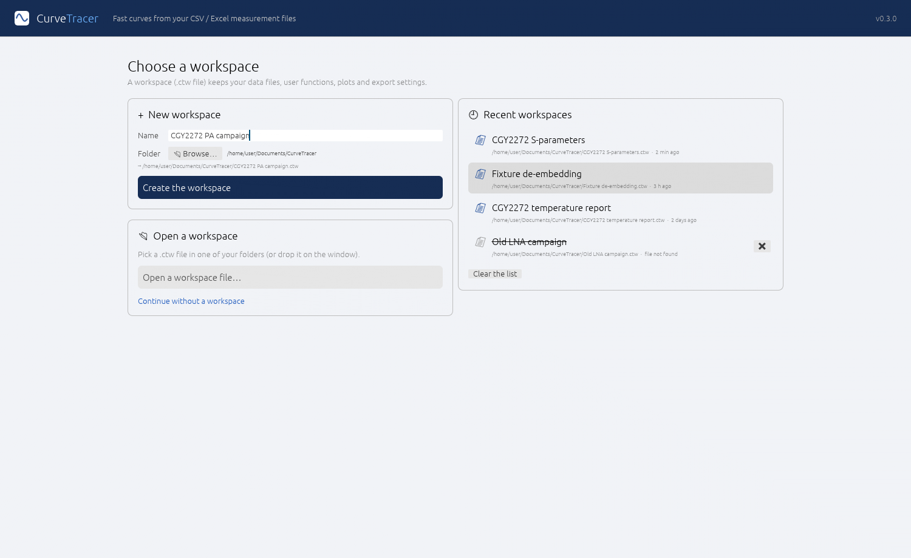

Au lancement, CurveTracer affiche l'écran **Choose a workspace** avant la page
principale :

- **New workspace** : saisir un **nom** et choisir le **dossier** (*Browse…* ;
  par défaut `Documents\CurveTracer`, ou le dossier du dernier workspace
  utilisé), puis **Create the workspace** (ou Entrée). Le fichier
  `nom.ctw` est créé immédiatement ; QuickSave / Ctrl+S l'enregistrent ensuite.
- **Open a workspace file…** : aller chercher un `.ctw` dans un de vos dossiers
  (on peut aussi le glisser-déposer sur la fenêtre).
- **Recent workspaces** : les workspaces créés ou ouverts récemment, du plus
  récent au plus ancien, avec leur emplacement et la date de dernière
  utilisation (« 2 min ago », « 3 h ago »…). Un clic l'ouvre. Un fichier
  déplacé ou supprimé est barré : la croix le retire de la liste (clic droit →
  *Remove from the list* pour les autres, *Clear the list* pour tout effacer).
- **Continue without a workspace** : travailler sans fichier `.ctw` (il pourra
  être enregistré plus tard).

La liste des récents est mémorisée dans le dossier de configuration de
l'utilisateur (`%APPDATA%\CurveTracer` sous Windows).

**À tout moment**, le menu **📁** de la barre du haut permet de créer un
nouveau workspace, d'en ouvrir un autre (fichier ou liste des récents),
d'enregistrer, ou de revenir à l'écran d'accueil. S'il y a des modifications
non enregistrées, CurveTracer demande d'abord **Save / Don't save / Cancel**.

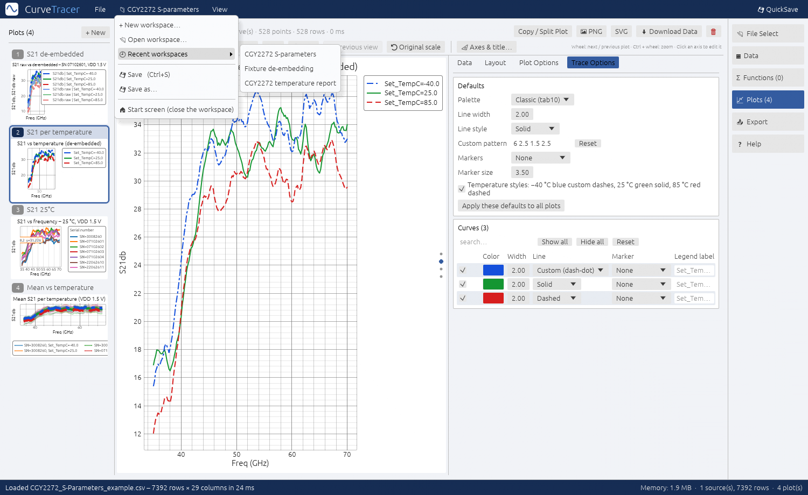

# 3. Charger des données (page *File Select*)

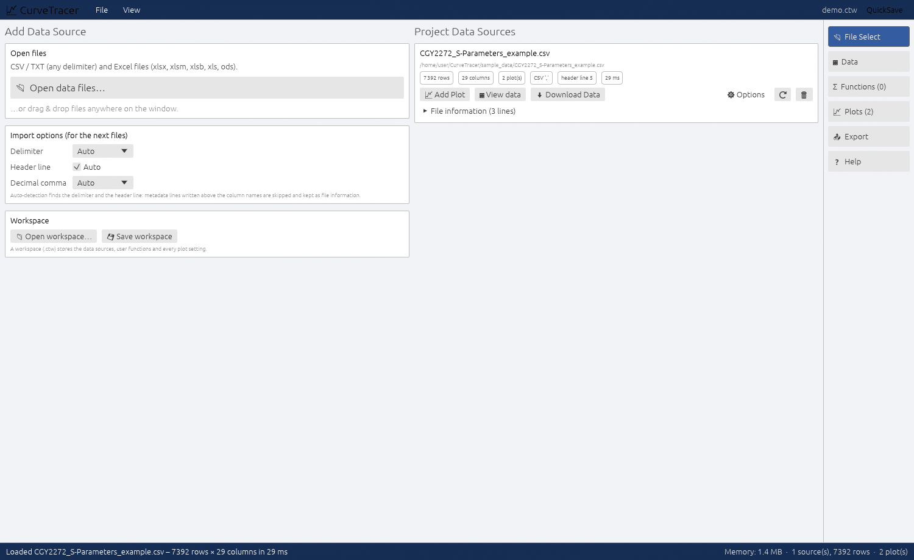

- **Open data files…** (ou glisser-déposer sur la fenêtre) : formats
  `csv`, `txt`, `tsv`, `dat`, `xlsx`, `xlsm`, `xlsb`, `xls`, `ods`, et
  fichiers **Touchstone** `.s1p`, `.s2p`, `.s3p`, `.s4p` … `.snp`.
  Plusieurs fichiers peuvent être chargés en même temps.
- **Fichiers Touchstone** : versions 1 et 2, formats DB / MA / RI, toutes
  unités de fréquence ; le nombre de ports vient de l'extension (ou du mot-clé
  `[Number of Ports]`). Le fichier devient un tableau avec une colonne
  **Freq** (Hz) et deux colonnes par paramètre : **S11db**, **S11deg**,
  **S12db**, **S12deg**, **S21db**… (au-delà de 9 ports : `S1_10db`). Les
  commentaires du fichier sont dans **File information**, la puce indique
  « Touchstone · n port(s) ». Un nouveau graphe sur ce fichier affiche
  directement **S21** (S11 pour un 1-port) en fonction de la fréquence en GHz ;
  le de-embedding et l'export de données fonctionnent comme pour un CSV.
- La détection est **automatique** :
  - délimiteur (`,` `;` tabulation `|`) ;
  - **ligne d'en-tête** : les lignes d'information placées au-dessus des noms de
    colonnes (Test Request ID, Part Number…) sont ignorées et visibles dans
    **File information** ;
  - virgule décimale (`1,5`), valeurs `N/A`, numéros de série avec zéros
    (`07102601`) conservés tels quels.
- Chaque fichier chargé apparaît dans **Project Data Sources** avec son nombre
  de lignes, de colonnes, de graphes, et les boutons :
  - **Add Plot** : crée un graphe sur ce fichier ;
  - **View data** : ouvre la page *Data* ;
  - **Download Data** : enregistre les données en CSV ;
  - **⚙ Options** : force le délimiteur, la ligne d'en-tête (numéro de ligne,
    0 = pas d'en-tête), la virgule décimale ou la feuille Excel, puis
    **Apply & reload** ;
  - **🔌 De-embedding** : retire les pertes des accès d'entrée / sortie
    (voir § 3.1) ;
  - **⟳** recharger le fichier, **🗑** le retirer du projet.
- **Import options (for the next files)** : mêmes réglages, appliqués aux
  prochains fichiers ouverts.

## 3.1 De-embedding des accès (fichiers `.s2p`)

Le bouton **🔌 De-embedding** d'un fichier de données ouvre le panneau qui
retire l'effet des **accès de mesure** (câbles, sondes, carte de test…) placés
entre l'instrument et le composant (DUT), décrits par des fichiers Touchstone
deux-ports `.s2p`.

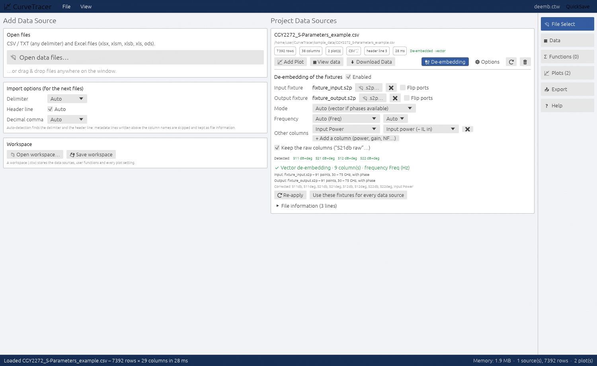

- **Enabled** : active / désactive le de-embedding (les données brutes sont
  rétablies quand il est désactivé).
- **Input fixture** : fichier `.s2p` de l'accès d'**entrée** — port 1 côté
  instrument, port 2 côté DUT.
- **Output fixture** : fichier `.s2p` de l'accès de **sortie** — port 1 côté
  DUT, port 2 côté instrument. Un seul des deux fichiers peut être donné.
- **Flip ports** : à cocher si le fichier a été mesuré dans l'autre sens
  (échange S11 ↔ S22 et S21 ↔ S12).
- **Mode** :
  - **Auto** : **vectoriel** si les données contiennent le module **et la
    phase** des quatre paramètres (`S11db`, `S11deg`, `S21db`, `S21deg`,
    `S12db`, `S12deg`, `S22db`, `S22deg`) et si les fichiers `.s2p` ont des
    phases ; **scalaire** sinon ;
  - **Vector** : impose le calcul vectoriel par matrices de transfert
    T : `T_DUT = T_in⁻¹ · T_mesure · T_out⁻¹` (corrige aussi les
    désadaptations des accès) ;
  - **Scalar** : soustraction des pertes en dB (accès supposés adaptés) :
    `S21 − S21_in − S21_out`, `S12 − S12_in − S12_out`,
    `S11 − (S21_in + S12_in)`, `S22 − (S21_out + S12_out)` ; les phases sont
    corrigées de la même façon si les fichiers en contiennent.
- **Frequency** : colonne des fréquences (détectée automatiquement : `Freq`,
  `Frequency`…) et son unité (**Auto** : Hz, MHz ou GHz déduits des valeurs).
  Les fichiers `.s2p` sont interpolés (dB et phase dépliée) à chaque fréquence
  de mesure ; hors de leur plage, le point le plus proche est utilisé et un
  avertissement est affiché.
- **Other columns** : d'autres colonnes peuvent être corrigées avec les pertes
  d'insertion (IL, en dB positifs, lues dans S21 des fichiers) :
  puissance d'entrée (− IL in), puissance de sortie (+ IL out),
  gain (+ IL in + IL out), facteur de bruit (− IL in), pertes en réflexion
  d'entrée / de sortie (+ 2·IL).
- **Keep the raw columns** : les colonnes sont **corrigées en place** (les
  graphes existants affichent donc directement les valeurs de-embeddées) et
  une copie des valeurs brutes est ajoutée (`S21db raw`, `S11deg raw`…) pour
  comparer.
- La ligne **Detected** indique les colonnes S-paramètres trouvées (vert : dB
  et phase). Le résultat affiche le mode utilisé, les fichiers (nombre de
  points, plage de fréquences, présence de phase) et les colonnes corrigées ;
  l'étiquette *De-embedded · vector / scalar* apparaît sur le fichier.
- **⟳ Re-apply** relit les fichiers `.s2p` (s'ils ont été modifiés) ;
  **Use these fixtures for every data source** copie ces réglages sur tous les
  fichiers du projet.

Les réglages de de-embedding sont enregistrés dans l'espace de travail, et
rappelés dans les diapositives au format *Plot + Settings*.

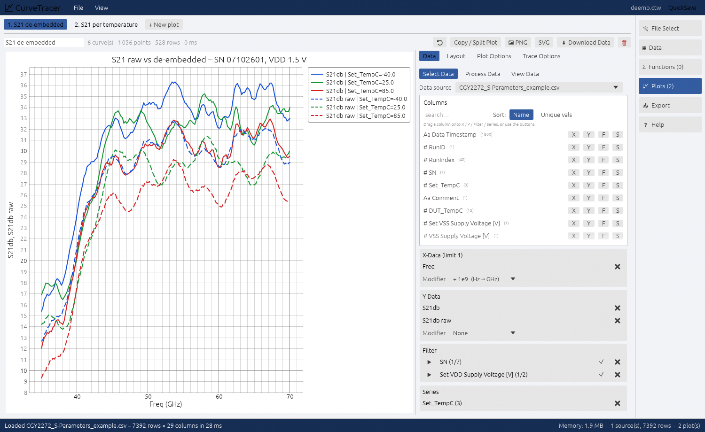

Deux fichiers d'exemple sont fournis : `sample_data/fixture_input.s2p` et
`sample_data/fixture_output.s2p`.

# 4. Consulter les données (page *Data*)

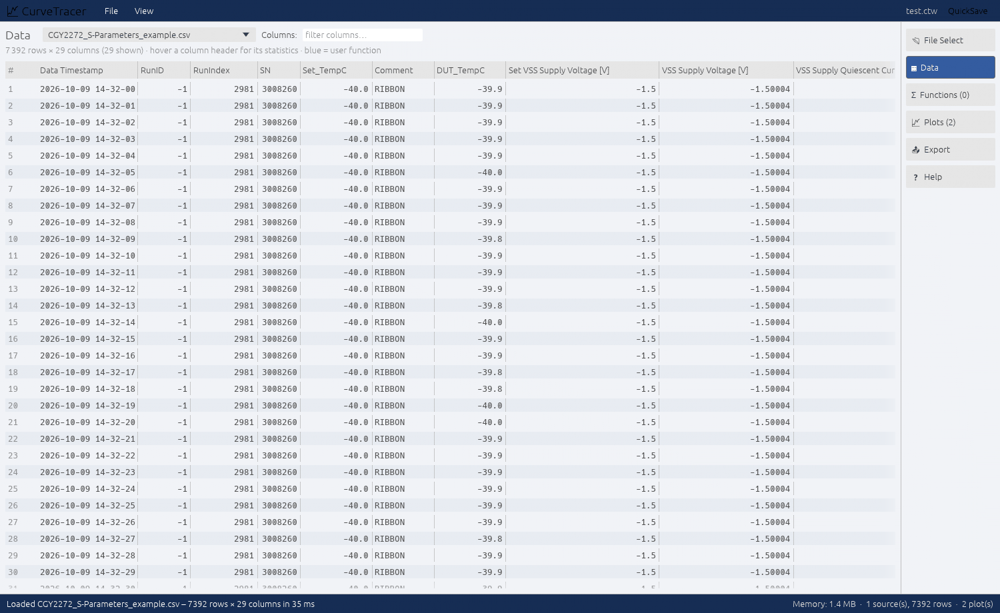

Choisir le fichier dans la liste déroulante. La table affiche toutes les lignes
(même plusieurs millions, le défilement reste fluide). Le champ **Columns**
filtre les colonnes par nom. Survoler un en-tête de colonne affiche son type,
son nombre de valeurs uniques et son min / max. Les colonnes en bleu sont des
fonctions utilisateur.

# 5. Créer un graphe (page *Plots*)

Cliquer **Add Plot** sur un fichier (page *File Select*) ou **+ New** au-dessus
de la liste des graphes.

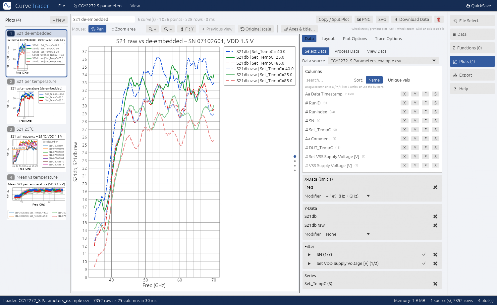

Le graphe est affiché **au format des images exportées** (6 : 4,2 par défaut,
voir § 8) et **agrandi** pour occuper toute la place disponible : ce que l'on
voit est ce qui sera exporté (proportions, taille relative des textes et de
la légende).

**Passer d'un graphe à l'autre** : les graphes sont **empilés verticalement**.
La **molette de la souris** sur le graphe fait défiler vers le graphe
**suivant / précédent** (avec une animation). On peut aussi utiliser
**Page Up / Page Down**, cliquer une **miniature** de la liste à gauche, ou
un point de l'indicateur à droite du graphe (le point bleu = graphe affiché).
La liste à gauche (redimensionnable) montre le numéro, le nom et une
**miniature fidèle** de chaque graphe (mêmes proportions et même mise en page
que le graphe affiché). Comme les diapositives d'un PowerPoint :

- **clic n'importe où sur la carte** : affiche ce graphe ;
- **glisser-déposer** une carte : la déplace (une ligne bleue montre la
  position d'arrivée ; la liste défile si on approche du bord) ;
- **clic droit** : *Duplicate (Copy / Split)*, *Move up / down*, *Move to
  the top / bottom*, *Delete* ; la copie prend le numéro suivant (« Plot 3 »
  → « Plot 4 », « S21 » → « S21 2 ») ;
- clavier, souris sur la liste : **Suppr** supprime le graphe affiché,
  **Ctrl+D** le duplique ;
- **Ctrl+Z** annule (un graphe supprimé revient à sa place), **Ctrl+Y**
  rétablit.

> Le zoom à la molette se fait maintenant avec **Ctrl + molette** (ou les
> boutons 🔍 de la barre d'outils).

La barre d'outils au-dessus du graphe contient, sur la 1ʳᵉ ligne : le **nom**
du graphe, un résumé (nombre de courbes, de points, de lignes, temps de
calcul) et les boutons **Copy / Split Plot**, **PNG** (image haute
résolution), **SVG** (image vectorielle, modifiable dans Inkscape, Illustrator
ou PowerPoint), **Download Data** (courbes en CSV) et **🗑** ; sur la 2ᵉ ligne,
les **outils de zoom / d'axes** (voir § 6).

Le panneau de droite contient quatre onglets : **Data**, **Layout**,
**Plot Options**, **Trace Options**.

## 5.1 Onglet Data → Select Data

- **Data source** : fichier utilisé par le graphe.
- **Columns** : liste des colonnes avec leur nombre de valeurs uniques
  (tri par nom ou par *Unique vals*, champ de recherche). Le symbole indique le
  type : `#` numérique, `Aa` texte, `#?` mixte. Pour utiliser une colonne :
  **la glisser** dans une des zones ci-dessous, ou cliquer sur
  **X**, **Y**, **F** (filtre) ou **S** (série).
- **X-Data (limit 1)** : la colonne en abscisse, avec son **Modifier** :

  | Modifier | Effet | Exemple |
  |---|---|---|
  | ÷ 1e9 (Hz → GHz) | divise par 10⁹ | `Freq` → `Freq (GHz)` |
  | ÷ 1e6 / ÷ 1e3 | divise par 10⁶ / 10³ | MHz, kHz |
  | × 1e3 (A → mA) | multiplie par 10³ | `Current [A]` → `Current [mA]` |
  | × 1e6 / × 1e9 | µ, n | |
  | Custom factor | multiplie par un facteur libre | |

  Une colonne de fréquence est automatiquement passée en GHz.
- **Y-Data** : une ou plusieurs colonnes (même choix de *Modifier*).
- **Filter** : ne garder que certaines lignes. Cliquer sur le filtre (▶) pour
  le déplier :
  - mode **Values** : cases à cocher par valeur, boutons **All**, **None**,
    **Invert**, recherche, et **only** pour ne garder qu'une valeur ;
  - mode **Range** : plage numérique `min … max` (bornes optionnelles).

  Le titre du filtre résume la sélection, ex. `Set_TempC (1/3)` = 1 valeur sur 3.
  La case à cocher active / désactive le filtre sans le supprimer.
- **Series** : **une courbe par valeur** de la colonne (SN, température,
  part number…). Plusieurs colonnes se combinent (`SN=…, Set_TempC=…`) ;
  **⬆** change l'ordre de regroupement.

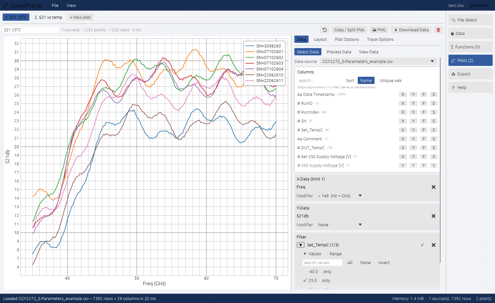

## 5.2 Onglet Data → Process Data

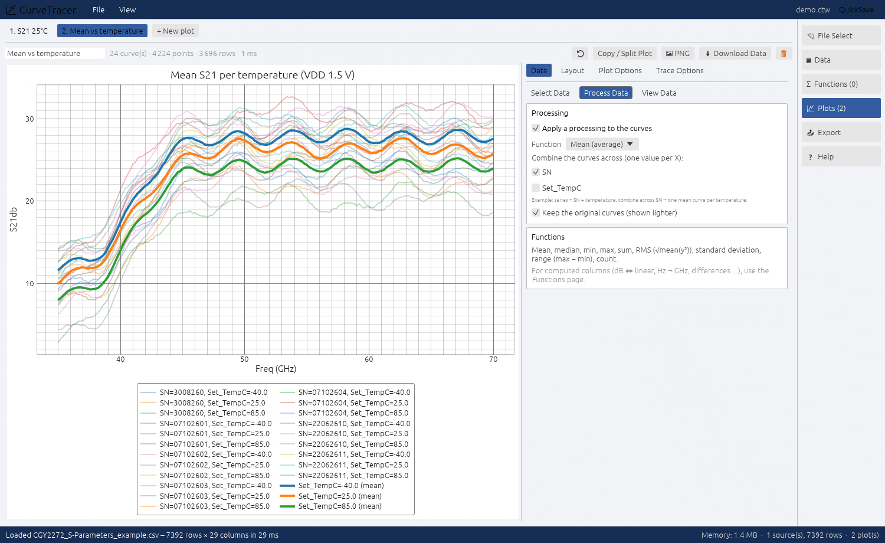

Cocher **Apply a processing to the curves** puis choisir la **Function** :
moyenne (*Mean*), médiane, min, max, somme, **RMS**, écart-type, étendue
(max − min) ou comptage. Le calcul se fait **pour chaque valeur de X** :

- sans série cochée : les points ayant le même X dans chaque courbe sont combinés ;
- avec des séries : cocher les colonnes à **combiner** (*Combine the curves
  across*). Exemple : séries = SN + température, combiner sur SN → une courbe
  moyenne par température ;
- **Keep the original curves** : affiche aussi les courbes d'origine, en plus
  clair, sous les courbes calculées (en trait épais).

### Lissage (*Smoothing*)

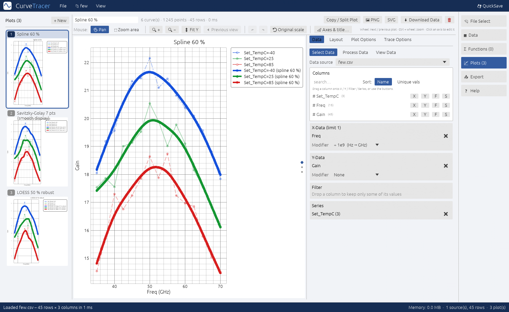

Cocher **Smooth the curves** pour lisser toutes les courbes du graphe (après le
traitement ci-dessus s'il est activé). Méthodes (*Method*) :

| Méthode | Principe | Réglage |
|---|---|---|
| **Smoothing spline** (recommandée, par défaut) | courbe continue et lisse qui suit la tendance des points (spline cubique pénalisée) ; excellente **même avec très peu de points** | *Smoothness* 0–100 % (0 = passe par les points, 100 % ≈ droite) |
| **LOESS** | régression locale pondérée sur une fraction des points autour de chaque X ; *Robust* ignore les points aberrants | *Span* (%), ajustement linéaire / quadratique |
| **Moving average** | moyenne des N points voisins ; simple, aplatit les pics | *Window* (points) |
| **Gaussian** | moyenne pondérée en cloche, plus douce que la moyenne glissante | *σ* (points) |
| **Savitzky–Golay** | ajuste un polynôme sur N points autour de chaque point : retire le bruit en gardant hauteur et largeur des pics, pentes et ondulations (idéal pour les S-paramètres) | *Window* + *Polynomial order* (2–3 conseillé) |
| **Median** | médiane des N voisins : supprime les pics isolés / glitches, garde les marches | *Window* (points) |
| **Exponential (zero-phase)** | moyenne exponentielle aller puis retour (pas de décalage de la courbe) | *Span* (points) |
| **Moving average (X width)** | moyenne des points à ± largeur / 2 sur l'axe X, pour un pas en X irrégulier | *Width* (unités de X, ex. 0.5 GHz) |

- **Passes** : applique le lissage plusieurs fois (plus lisse ; méthodes à fenêtre).
- **Display → Smooth curve between the points** (coché par défaut) : la
  courbe lissée est tracée comme une **courbe continue** (400 points par
  défaut) au lieu de segments droits entre les points : indispensable quand la
  courbe a peu de points. Pour les méthodes à fenêtre, l'interpolation est
  monotone (pas de dépassement : les marches restent des marches).
- **Keep the raw curves** : garde les courbes brutes en clair sous les courbes
  lissées (en trait épais), dont la légende indique la méthode
  (`SG 41 pts, ord 3`).
- **Presets** : *Light*, *Medium*, *Strong* (spline 30 / 50 / 70 %),
  *Trend* (LOESS robuste sur la moitié des points) et *Remove spikes*
  (médiane sur 5 points).

Aux extrémités, la fenêtre se réduit symétriquement (Savitzky–Golay utilise le
polynôme de la première / dernière fenêtre) : les bords ne sont pas décalés.
Les courbes lissées sont exportées (PowerPoint, images, CSV) comme les autres.

## 5.3 Onglet Data → View Data

Table des lignes retenues par les filtres (colonnes X, Y, séries et filtres ;
cocher **All columns** pour tout voir).

## 5.4 Onglet Layout

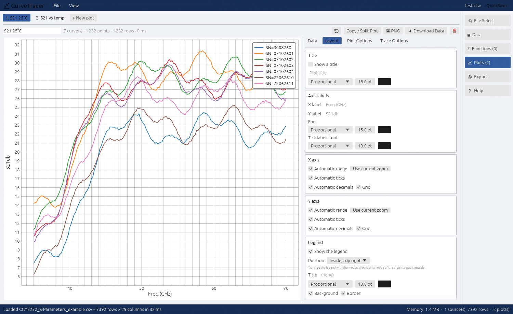

- **Title** : afficher ou non un titre, son texte, sa police / taille / couleur.
- **Axis labels** : libellés X et Y (vide = automatique, à partir du nom de
  colonne et du *Modifier*), police des libellés, police des graduations
  (*Tick labels font*).
- **X axis / Y axis** :
  - **Automatic range** décoché : plage d'affichage `from … to` ;
    **Use current zoom** recopie la vue actuelle ;
  - **Automatic ticks** décoché : **pas des graduations** (ex. 5 GHz, 2 dB) ;
  - **Automatic decimals** décoché : nombre de décimales des graduations ;
  - **Grid** : grille.
- **Legend** : affichage, position (intérieur / extérieur, en haut, à droite…),
  titre, police, fond, bordure.
- **Colors** : couleur de fond et de grille.
- **Apply this layout to all plots** : recopie polices, légende, grille et
  couleurs sur tous les graphes (titres, libellés et plages sont conservés).

Les polices proposées : *Proportional*, *Monospace*, et les polices installées
(Arial, Calibri, Segoe UI, Times New Roman, Courier New, Consolas…).
**File → Load a font file** ajoute n'importe quel `.ttf` / `.otf`.

## 5.5 Onglet Plot Options

- **Sort the points by X** : trie les points de chaque courbe ;
- **Start a new line when X goes backwards** : un nouveau balayage (ex. une
  autre tension non filtrée) démarre un nouveau trait au lieu de tracer un
  retour ;
- **Fast drawing of huge curves** : décimation min/max (sans perte visible) ;
- **Show the values under the mouse**, **Crosshair** ;
- **Markers** : liste des curseurs posés (voir § 6) ;
- **Export** : inclure le graphe dans les exports, titre de diapositive.

## 5.6 Onglet Trace Options

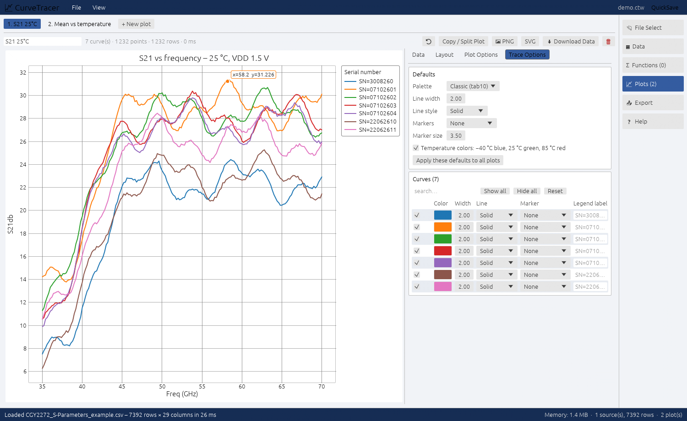

- **Defaults** : palette de couleurs, épaisseur (**2 px** par défaut), style
  de trait (plein, tirets, pointillés, **Custom**, aucun), marqueurs et leur
  taille ; **Apply these defaults to all plots**.
- **Custom pattern** : motif du style **Custom (dash-dot)**, sous la forme
  `trait espace trait espace…` en multiples de l'épaisseur du trait. Par
  défaut `6 2.5 1.5 2.5` = tiret long, espace, tiret court, espace (tiret-point).
  *Reset* rétablit ce motif.
- **Temperature styles** (coché par défaut) : quand la série est une
  température (`Set_TempC`, `DUT_TempC`…) :
  - **−40 °C : bleu, trait *Custom*** (tiret-point) ;
  - **25 °C : vert, trait plein** ;
  - **85 °C : rouge, tirets**.

  Si plusieurs colonnes Y sont tracées (ex. `S21db` et `S21db raw`), la 2ᵉ et
  la 3ᵉ gardent ces styles avec des couleurs plus claires.
- **Curves** : pour chaque courbe — visibilité, couleur, épaisseur, style,
  marqueur et **libellé de légende personnalisé**. **Show all / Hide all /
  Reset** agissent sur toutes les courbes.

# 6. Explorer un graphe

| Action | Effet |
|---|---|
| **Molette** | graphe **suivant / précédent** |
| **Ctrl + molette** | zoom autour de la souris |
| Glisser (clic gauche) | déplacer la vue (mode *Pan*) ou dessiner la zone à zoomer (mode *Zoom area*) |
| **Bouton du milieu (molette) maintenu** + glisser | déplacer la vue, quel que soit le mode |
| **Échap** | quitte le mode *Zoom area* (retour à *Pan*) |
| Clic droit + glisser | zoom sur un rectangle |
| Glisser sur un axe | zoom sur cet axe seulement |
| **Clic sur un axe / le titre** | l'éditer (§ 6.1) |
| Double-clic | revenir à l'échelle d'origine |
| Survol | valeurs x / y de la courbe la plus proche |
| **Clic sur une courbe** | pose un **curseur** avec ses valeurs x / y |
| Clic sur un curseur | le supprime |
| **Ctrl+Z / Ctrl+Y** | annule / rétablit les curseurs posés ou retirés, et les graphes supprimés, dupliqués ou déplacés (boutons ↶ ↷ de la barre d'outils) |
| Clic droit | menu : *Reset view*, *Previous view*, *Axes & title…*, *Clear markers* |

**Outils de la barre d'outils** (2ᵉ ligne) :

| Outil | Effet |
|---|---|
| **✋ Pan** / **⬚ Zoom area** | rôle du glisser gauche : déplacer la vue, ou tracer le rectangle sur lequel zoomer |
| **🔍 +** / **🔍 −** | zoom avant / arrière autour du centre |
| **↕ Fit Y** | ajuste l'axe Y aux courbes visibles dans la plage X affichée |
| **⏴ Previous view** | revient au zoom précédent (historique des vues) |
| **⟲ Original scale** | revient à l'échelle d'origine (plages configurées ou automatiques) |
| **📐 Axes & title…** | ouvre l'éditeur des deux axes et du titre |

**La légende** se déplace à la souris. Déposée **contre un bord** du graphe,
elle passe **à l'extérieur du cadre** et le graphe se réduit automatiquement
pour lui laisser la place. Un clic sur une entrée masque / affiche la courbe
correspondante. Quand il y a beaucoup de courbes, la légende se répartit sur
plusieurs colonnes. **Clic droit sur la légende** :

- **This entry** : nouveau texte de l'entrée cliquée (vide = texte
  automatique) ;
- **Variable names** : nom affiché à la place de chaque **variable**
  (colonnes Y et colonnes de séries) dans **toutes** les entrées — par
  exemple `S21db` → *Gain* et `Set_TempC` → *Temp* donnent « Gain |
  Temp=-40.0 » ; les exports (PNG, SVG, PowerPoint) utilisent ces noms ;
- police, taille (en saisie ou 9 / 11 / 13 / 16 / 20), couleur du texte, fond,
  bordure, ou masquer la légende.

Le menu reste ouvert pendant la saisie ; un clic à l'extérieur ou **Échap**
le ferme.

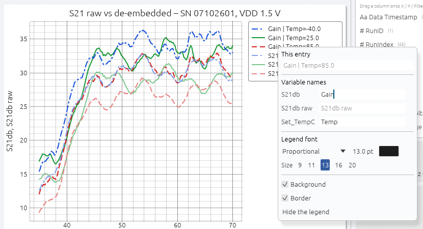

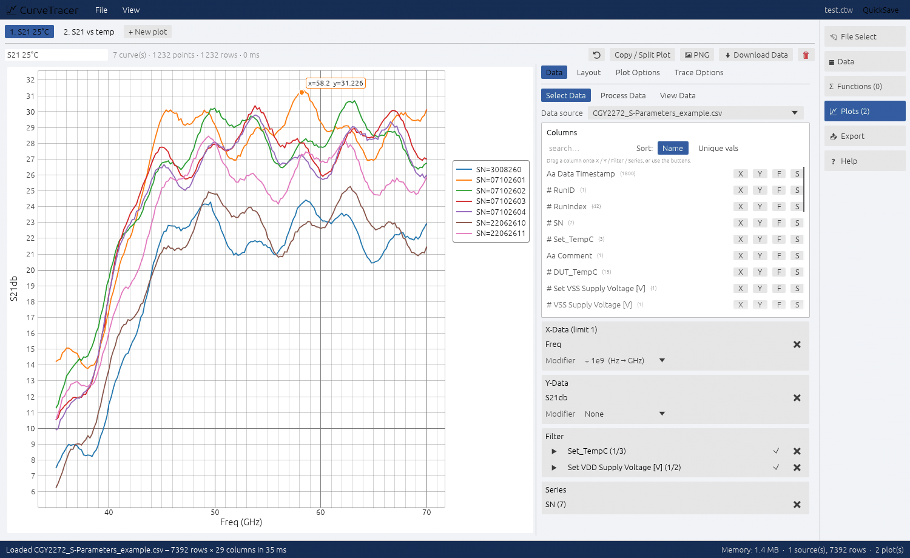

## 6.1 Renommer et régler un axe en cliquant dessus

Survoler un axe l'encadre en bleu ; **un clic** (sans glisser) ouvre son
éditeur :

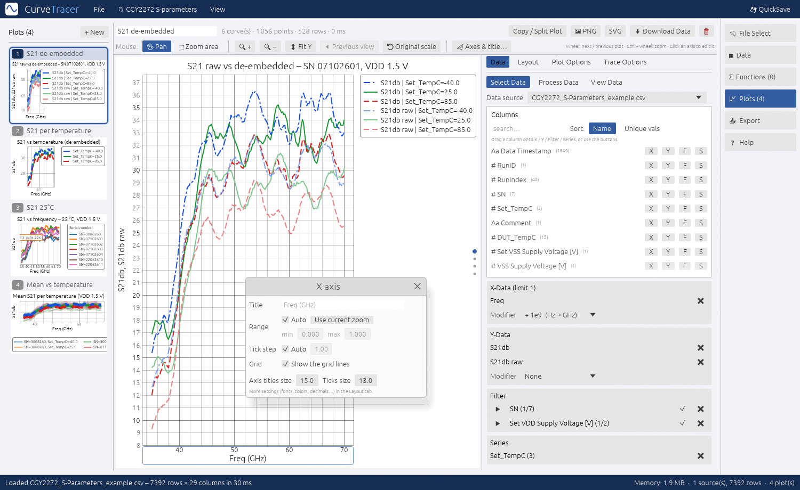

- **Title** : nom de l'axe (vide = nom automatique, tiré de la colonne et de
  son unité, affiché en grisé) ;
- **Range** : *Auto*, ou **min / max** imposés ; *Use current zoom* reprend la
  plage affichée ;
- **Tick step** : *Auto* ou pas imposé ;
- **Grid** : afficher le quadrillage ;
- tailles des titres d'axes et des graduations.

Un clic sur le **titre** du graphe ouvre l'éditeur du titre (texte, affichage,
taille). Les modifications sont immédiates et enregistrées avec le graphe
(mêmes réglages que l'onglet *Layout*).

# 7. Fonctions utilisateur (page *Functions*)

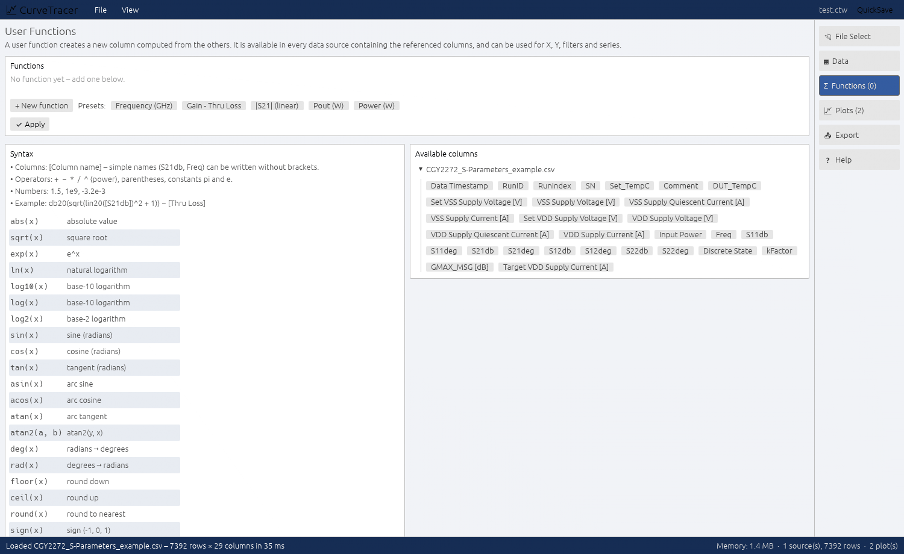

Une fonction crée une **nouvelle colonne** calculée à partir des autres. Elle
est disponible dans tous les fichiers qui contiennent les colonnes utilisées,
et s'utilise comme une colonne normale (X, Y, filtre, série). Elle apparaît
dans la liste des colonnes sous **User Functions**.

- **+ New function**, saisir le **nom** et l'**expression**, puis **✔ Apply**
  (ou quitter le champ). La colonne *Status* indique dans combien de fichiers
  la fonction est valide (survoler pour voir les erreurs).
- Colonnes : entre crochets `[VDD Supply Current [A]]`, ou directement si le
  nom est simple (`S21db`, `Freq`). Cliquer une colonne dans *Available
  columns* copie `[nom]` dans le presse-papier.
- Opérateurs : `+ - * / ^`, parenthèses, constantes `pi` et `e`.
- Fonctions : `abs sqrt exp ln log10 log2 sin cos tan asin acos atan atan2
  deg rad floor ceil round sign min max pow hypot`, et pour la RF :
  `db10(x)` = 10·log10(x), `db20(x)` = 20·log10(|x|), `lin10(x)` = 10^(x/10),
  `lin20(x)` = 10^(x/20), `dbm2w(x)`, `w2dbm(x)`.

Exemples :

| Nom | Expression |
|---|---|
| Frequency (GHz) | `[Freq] / 1e9` |
| Gain - Thru Loss | `[S21db] - [Thru Loss]` |
| NF + Input Loss | `[NF] + 0.8` |
| DC power (W) | `[VDD Supply Voltage [V]] * [VDD Supply Current [A]]` |

# 8. Exporter les graphes (page *Export Plots*)

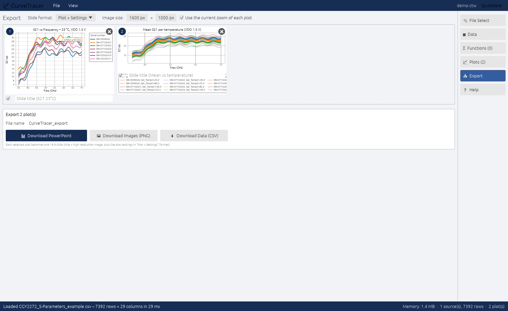

- Les **miniatures** de tous les graphes sont affichées : la case à cocher
  inclut / exclut un graphe, le champ texte donne le **titre de la diapositive**
  (vide = titre ou nom du graphe), la croix (🗙) retire le graphe de l'export,
  double-clic ouvre le graphe.
- **Slide format** : *Plot only* ou *Plot + Settings* (ajoute à droite la
  source, X, Y, séries, filtres et traitement).
- **Image size** : taille des images en pouces et résolution — par défaut
  **6 × 4,2 in à 300 dpi** (1800 × 1260 px), le format des rapports de test.
  Les PNG portent leur résolution et les SVG leur taille en pouces : Word ou
  PowerPoint les insèrent directement à 6 × 4,2 in ; dans le PowerPoint
  exporté, chaque graphe est placé à cette taille. L'image est **à l'échelle
  du graphe affiché** : textes, légende, marges et traits ont les mêmes
  proportions qu'à l'écran (une légende qui tient à l'écran tient dans
  l'export). Le bouton **6 × 4.2** revient au format standard.
- **Format demandé à l'export** : si la taille n'est pas dans le rapport
  **6 : 4,2**, ou si **Ask at each export** est coché, la fenêtre *Image
  format* s'ouvre avant chaque export (PowerPoint, images, boutons PNG / SVG
  de la page *Plots*) : formats 6 × 4,2 / 8 × 5,6 / 4 × 2,8 in, largeur ×
  hauteur libres (case **6 : 4.2** pour garder le rapport), résolution.
- **Images** : format des images exportées, **PNG** (bitmap) ou **SVG**
  (vectoriel : traits et textes nets à tous les zooms, textes modifiables).
- **Vector (SVG) plots in the PowerPoint** (coché par défaut) : chaque
  diapositive contient le graphe en **SVG** (PowerPoint 2016 / Microsoft 365 :
  net à tous les zooms, *Convertir en forme* pour le modifier), avec une copie
  PNG pour les logiciels qui ne lisent pas le SVG.
- **Use the current zoom of each plot** : exporte la vue affichée plutôt que la
  plage complète.
- **File name**, puis :
  - **Download PowerPoint** : un fichier `.pptx`, une diapositive 16:9 par graphe ;
  - **Download Images (PNG / SVG)** : une image par graphe dans le dossier choisi ;
  - **Download Data (CSV)** : les points de chaque graphe (colonnes *Trace, X, Y*).

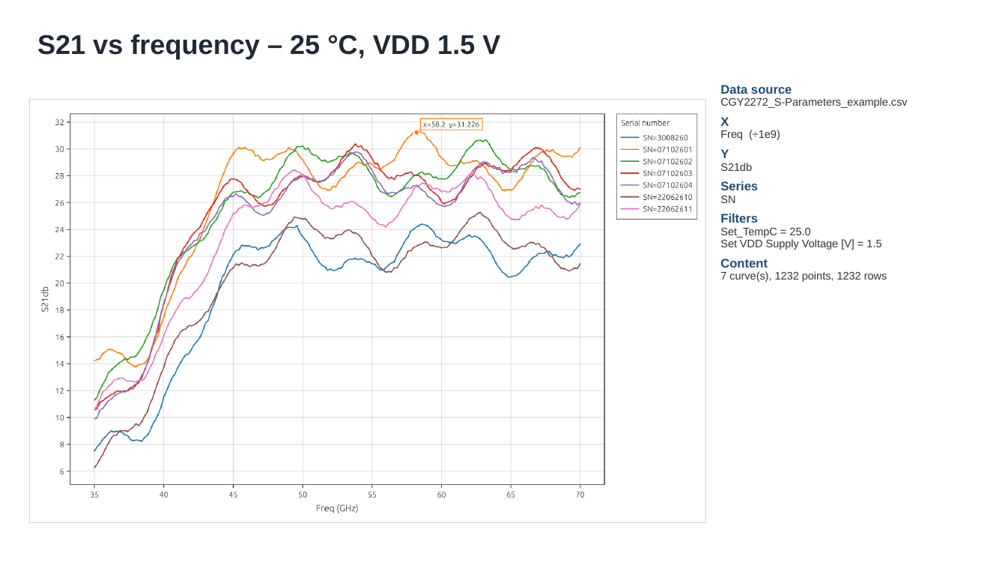

# 9. Exporter des données (page *Export Data*)

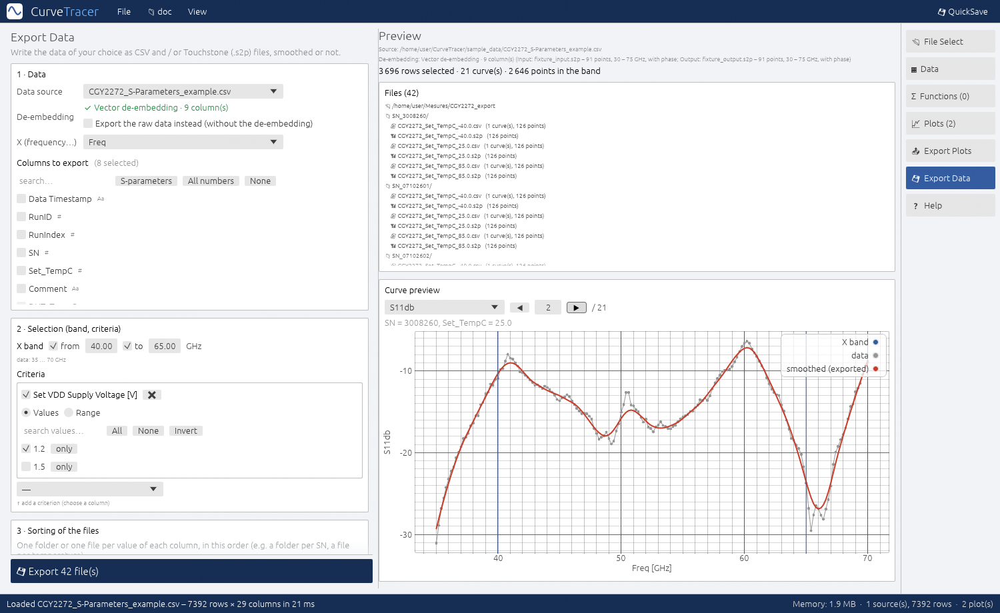

Cette page écrit les **données elles-mêmes** (pas les graphes) dans des
fichiers **CSV** et / ou **Touchstone `.s2p`**, avec le **de-embedding**
éventuel déjà appliqué et un **lissage** facultatif. Elle se règle de haut en
bas ; l'aperçu à droite se met à jour à chaque changement : nombre de lignes,
de courbes et de points retenus, **arborescence des fichiers** qui seront
écrits et **aperçu d'une courbe** (données brutes en gris, valeurs exportées en
rouge, limites de la bande en bleu).

**1 · Data**

- **Data source** : le fichier à exporter.
- **De-embedding** : si un de-embedding est actif sur ce fichier (§ 3.1), les
  valeurs exportées sont les valeurs **corrigées**. Cocher *Export the raw data
  instead* pour exporter les valeurs brutes.
- **X (frequency…)** : la colonne X, en général la fréquence (choisie
  automatiquement).
- **Columns to export** : les colonnes écrites dans les CSV. Boutons
  *S-parameters* (S11 … S22 en dB et en phase), *All numbers*, *None*, et
  recherche par nom.

**2 · Selection (band, criteria)**

- **X band** : bande à exporter, par exemple *from 40 to 65 GHz* (pour une
  fréquence, les valeurs sont saisies en GHz ou dans l'unité choisie pour les
  `.s2p`). Seuls les points de la bande sont écrits.
- **Criteria** : critères de sélection sur n'importe quelle colonne, comme les
  filtres des graphes : liste de valeurs (SN, température, état…) ou plage
  numérique (gamme de **puissance d'entrée**, tension…). Choisir la colonne
  dans la liste déroulante pour ajouter un critère ; 🗙 le retire.

**3 · Sorting of the files**

- **Niveaux de rangement** : une colonne par niveau, chacun en **📁 Folder**
  (un sous-dossier par valeur) ou **📄 File name** (une partie du nom de
  fichier par valeur). Exemple : *SN* en dossier puis *Set_TempC* en nom de
  fichier donne `SN_3008260/CGY2272_Set_TempC_-40.0.csv`, `…_25.0.csv`… ;
  ⏶ ⏷ changent l'ordre, 🗙 retire un niveau. Sans niveau, tout va dans un seul
  fichier CSV.
- **Column names in the folder / file names** : `SN_3008260` plutôt que
  `3008260` (les unités entre crochets sont retirées des noms).
- **File names start with** : début des noms de fichiers (par défaut le nom du
  fichier de données).
- **Curves** : une **courbe** est l'ensemble des points qui ont les mêmes
  valeurs dans les colonnes indiquées (*A curve = SN Set_TempC …*), triés par
  X. Ces colonnes sont **trouvées automatiquement** (les colonnes de
  conditions — SN, température, alimentation, état… — qui rendent chaque
  fréquence unique dans une courbe) ; décocher la case pour les choisir à la
  main. Chaque courbe est lissée séparément et donne **un fichier `.s2p`**.
  Si des fréquences se répètent dans une courbe, un avertissement l'indique :
  ajouter une colonne ou un critère.

**4 · Smoothing**

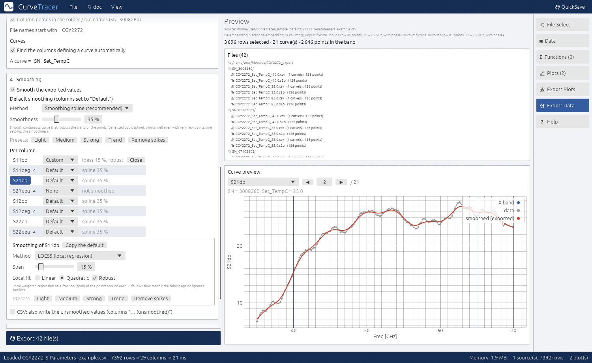

- **Smooth the exported values** active le lissage.
- **Default smoothing** : la méthode et les réglages utilisés par toutes les
  colonnes réglées sur *Default* — les mêmes méthodes que pour les graphes
  (§ 5.2) : spline de lissage, LOESS, moyenne glissante, gaussien,
  Savitzky–Golay, médiane, exponentiel, moyenne sur une largeur en X, avec les
  préréglages *Light / Medium / Strong / Trend / Remove spikes*.
- **Per column** : pour chaque colonne, **Default**, **Custom** (ses propres
  réglages : *✏ Edit* ouvre l'éditeur, *Copy the default* part du réglage par
  défaut) ou **None** (non lissée). Exemple : LOESS robuste sur S11, spline
  sur S21, aucune modification des phases. Cliquer sur le nom d'une colonne
  l'affiche dans l'aperçu.
- Chaque courbe est lissée sur **toute sa plage** puis coupée à la bande : pas
  de déformation aux limites de la bande. Les **phases** (colonnes `…deg`,
  marquées ∠) sont **déroulées** avant le lissage (pas de saut à ±180°) puis
  ramenées entre −180° et +180°.
- Les valeurs lissées sont calculées **aux fréquences mesurées** : les lignes
  exportées gardent leurs valeurs de X.
- **CSV: also write the unsmoothed values** ajoute, après chaque colonne
  lissée, une colonne « … (unsmoothed) » avec la valeur d'origine.

**5 · Formats and folder**

- **CSV** : séparateur virgule, point-virgule ou tabulation ; **decimal
  comma** pour un Excel français (avec le séparateur `;`). Colonnes écrites :
  les colonnes de courbe (SN, température…), X, puis les colonnes choisies.
- **Touchstone (.snp)** : un fichier par courbe, format **DB** (dB / angle),
  **MA** (module / angle) ou **RI** (réel / imaginaire), unité de fréquence
  (Hz … GHz), impédance de référence **R**. *Frequency unit of the data* :
  unité de la colonne X (détectée automatiquement).
  - **Nombre de ports** : déterminé à partir des colonnes S-paramètres
    reconnues par leur nom (`S21db`, `S21deg`, `S31 [dB]`, `S1_10db`…) :
    « *4 port(s) in the data* ». Les cases **ports written** restreignent
    l'export : décocher des ports écrit un réseau plus petit, renuméroté
    (ports 2 et 4 d'un 4-ports → fichier `.s2p` dont S21 est le S42 des
    données). L'extension suit : `.s1p`, `.s2p`, `.s3p`, `.s4p`…
  - « *n parameters found* » indique si tous les paramètres sont présents ;
    *Columns…* permet de choisir la colonne de chaque paramètre. Un paramètre
    absent est écrit à 0 (et signalé dans l'en-tête), une phase absente vaut
    0°.
  - Mise en page Touchstone 1 : 2-ports sur une ligne (S11 S21 S12 S22),
    au-delà une ligne par rangée de la matrice (4 paramètres par ligne au
    plus). L'en-tête rappelle la source, le de-embedding, la courbe, les ports
    écrits et le lissage de chaque paramètre.

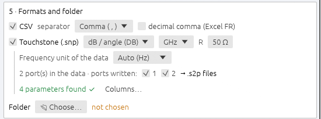
- **Folder** : le dossier de destination (*📂 Choose…*). Les fichiers de même
  nom sont remplacés.
- **💾 Export N file(s)** : écrit les fichiers en tâche de fond (barre de
  progression, *Cancel*). À la fin, le nombre de fichiers et la durée sont
  affichés, avec *Open the folder*. Un fichier `…_export_info.txt` écrit à
  côté des données résume tous les réglages (source, de-embedding, bande,
  critères, lissage de chaque colonne).

L'export est rapide : environ **2 s pour un million de lignes**, et quelques
secondes pour plusieurs milliers de fichiers `.s2p`. Tous les réglages de la
page sont enregistrés dans l'espace de travail.

# 10. Espaces de travail

Un espace de travail (`.ctw`) contient la liste des fichiers de données et
leurs options (de-embedding compris), les fonctions utilisateur, tous les
graphes et leurs réglages, et les options d'export. Les fichiers de données
eux-mêmes ne sont pas copiés : ils sont relus depuis leur emplacement
d'origine.

- **Créer / ouvrir** : écran d'accueil (§ 2.1) ou menu **📁** de la barre du
  haut (*New workspace…*, *Open workspace…*, *Recent workspaces*), ou
  glisser-déposer un `.ctw` sur la fenêtre.
- **Enregistrer** : **QuickSave**, **Ctrl+S** ou **📁 → Save** ; **📁 → Save
  as…** pour une copie sous un autre nom.
- **Changer de workspace** : si le workspace courant a des modifications non
  enregistrées, CurveTracer propose **Save**, **Don't save** ou **Cancel**
  (de même à la **fermeture de la fenêtre**).

Astuce : associer l'extension `.ctw` à `CurveTracer.exe` dans Windows permet
d'ouvrir un projet par double-clic.

# 11. Presets de style (menu *🎨 Presets*)

Un **preset** est un **modèle de présentation** réutilisable. À la
différence d'un espace de travail, il ne contient **aucune donnée** : ni
fichier, ni graphe, ni colonne, ni filtre, ni texte (titres, noms d'axes),
ni plage d'axes. Il s'applique donc à n'importe quel graphe de n'importe quel
workspace.

| | Espace de travail (`.ctw`) | Preset (`.ctp`) |
|---|---|---|
| Fichiers de données, de-embedding, fonctions | oui | non |
| Graphes (X, Y, filtres, séries, titres, plages, curseurs) | oui | non |
| Polices (titre, noms d'axes, graduations, légende), tailles, couleurs | oui | **oui** |
| Palette, épaisseur et style des courbes, marqueurs, styles des températures | oui | **oui** |
| Légende (position, fond, cadre), grille, couleurs de fond | oui | **oui** |
| Taille des images exportées (6 × 4,2 in…), résolution, format des diapositives | oui | **oui** (au choix) |
| Où | où l'on veut | dossier des réglages de CurveTracer, partageable par fichier |

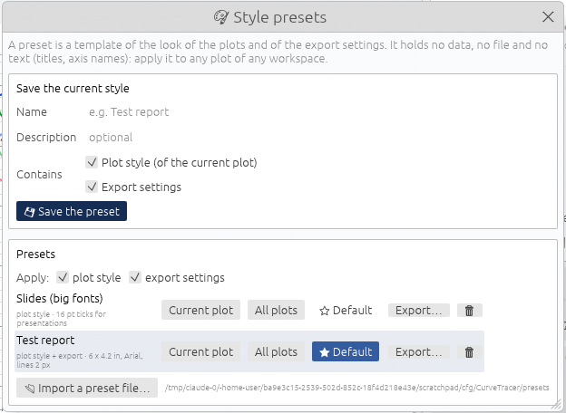

**Créer un preset** : régler un graphe comme souhaité (onglets *Layout*,
*Trace Options*, clic droit sur la légende…), puis **🎨 Presets → Save the
current style as a preset…** : nom, description, et contenu — **Plot
style** (le style du graphe affiché) et / ou **Export settings** (taille des
images, résolution, format des diapositives, PNG / SVG).

**Appliquer un preset** :

- menu **🎨 Presets → *nom* → Apply to the current plot / Apply to all the
  plots** ;
- ou dans la fenêtre **Manage the presets…** : boutons **Current plot** et
  **All plots**, avec le choix de ce qui est appliqué (*plot style*, *export
  settings*).

Les données, titres, noms d'axes, plages et réglages propres à chaque courbe
(couleur forcée, nom dans la légende…) sont **conservés**. **Ctrl+Z** annule
l'application d'un preset.

**Preset par défaut (★)** : *☆ Use for new plots and workspaces* (ou le
bouton *☆ Default* de la fenêtre). Les nouveaux graphes prennent son style et
les nouveaux workspaces ses réglages d'export. Cliquer à nouveau pour le
retirer.

**Partager** : *Export…* enregistre un preset dans un fichier `.ctp` (à
envoyer à un collègue, à mettre sur un serveur commun) ; **Import a preset
file…** l'ajoute à sa liste. Les presets sont rangés dans le dossier des
réglages de CurveTracer (`%APPDATA%\CurveTracer\presets` sous Windows),
indiqué en bas de la fenêtre.

# 12. Questions fréquentes

**Le graphe affiche « Select an X column and at least one Y column ».**
Choisir X et au moins un Y dans *Data → Select Data*.

**Aucune courbe n'apparaît / « No row matches the filters ».**
Un filtre exclut toutes les lignes : vérifier les valeurs cochées (`(0/3)`).

**Les courbes font des allers-retours.**
Plusieurs balayages sont mélangés dans une même série : ajouter un filtre ou une
série sur la colonne qui varie (tension, état…), ou cocher *Sort the points by X*.

**Les colonnes sont mal découpées / l'en-tête est faux.**
Dans *File Select → ⚙ Options*, forcer le délimiteur ou le numéro de la ligne
d'en-tête, puis *Apply & reload*.

**Les nombres avec une virgule ne sont pas reconnus.**
*⚙ Options → Decimal comma → Yes*.

**Le de-embedding affiche « frequencies outside the fixture files ».**
L'unité de fréquence est probablement mal déduite : la choisir dans
*Frequency* (Hz, MHz, GHz), ou vérifier que les fichiers `.s2p` couvrent la
plage mesurée.

**Le de-embedding est scalaire alors que j'attends du vectoriel.**
Il faut les colonnes dB **et** phase des quatre paramètres (S11, S21, S12,
S22) et des phases non nulles dans les deux fichiers `.s2p` : la ligne
*Detected* et le message sous le résultat indiquent ce qui manque.

**La légende cache les courbes.**
La déplacer à la souris, ou la poser contre le bord droit / bas pour la sortir
du cadre (ou *Layout → Legend → Position*).
